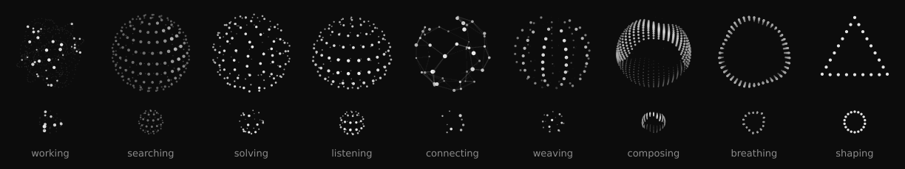
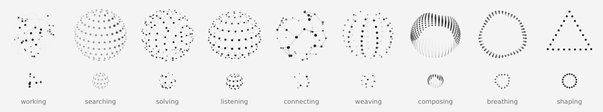

# thinking-orbs-pyside6

Dotted thought-orb loading indicators for **PySide6 / Qt** desktop apps — a faithful Python port of [thinking-orbs](https://github.com/Jakubantalik/thinking-orbs) by [Jakub Antalik](https://github.com/Jakubantalik).

Nine hand-tuned animated states, each shipped at two purpose-tuned sizes. Strictly monochrome: depth is carried by dot size and ink weight alone. Plain `QPainter` circle fills — no OpenGL, no shaders, no dependencies besides PySide6.

**On a dark background**



**On a light background**



<sub>Top row: `size=64`, bottom row: `size=20`, both drawn at 2× for the preview.</sub>

## Same orbs, pixel for pixel

This is not a look-alike. The engine is a line-by-line transcription of the original TypeScript (`src/engine/*.ts` + `src/presets.ts`, spec 1.0.0): same formulas, same presets, same z-sorted draw order.

It is verified against the original project's own golden vectors (`spec/orbs-golden.json`, generated by the JS engine): **72 cases (9 states × 2 sizes × 4 timestamps), 70,115 values, all identical** within the spec's 1e-4 tolerance. A frame rendered by this port and the same frame rendered by the original canvas code in Chromium differ by a mean of 0.16/255 per pixel — antialiasing at dot edges only.

```bash
python tests/test_golden.py
# 72/72 cases pass, 70115 values, worst abs error 5.00e-07 (tolerance 0.0001)
```

## Install

It is a single file. Either copy `thinking_orbs.py` into your project, or install from GitHub:

```bash
pip install git+https://github.com/gen-x-coder/thinking-orbs-pyside6
```

Requires Python 3.9+ and PySide6 6.2+.

## Quick start

```python
from PySide6.QtWidgets import QApplication
from thinking_orbs import ThinkingOrb

app = QApplication([])
orb = ThinkingOrb(state="searching", size=64)
orb.show()
app.exec()
```

Run the module directly for an interactive playground with all states, both sizes, a speed slider, pause and a light/dark toggle:

```bash
python thinking_orbs.py
```

`examples/chat_status.py` shows an orb next to a status line, stepping through a few agent states.

## States

Nine verbs an agent can be doing, each a distinct animation:

```python
ThinkingOrb(state="working")     # particles on tilted orbits
ThinkingOrb(state="searching")   # a scan meridian sweeps a dotted globe
ThinkingOrb(state="solving")     # bands scramble, then click back solved
ThinkingOrb(state="listening")   # a waveform rolls through the rings
ThinkingOrb(state="connecting")  # a constellation wires itself
ThinkingOrb(state="weaving")     # three strands plait around the sphere
ThinkingOrb(state="composing")   # an undulating multi-band sash
ThinkingOrb(state="breathing")   # a ring slowly morphing
ThinkingOrb(state="shaping")     # dotted outline: circle → triangle → square
```

## Sizes

Two tuned presets — separate designs, not a scale factor. `64` for chat-avatar scale, `20` for inline-text scale. Each carries its own dot count, dot size and speed tuning:

```python
ThinkingOrb(state="working", size=64)
ThinkingOrb(state="working", size=20)
```

The widget's natural size is `size × size` px. Give it more room (`setFixedSize(192, 192)`, or a stretching layout) and the whole drawing scales up uniformly, centred.

## Theme

Light ink for dark backgrounds, dark ink for light backgrounds:

```python
ThinkingOrb(theme="auto")    # default — follows the widget's palette (Window colour)
ThinkingOrb(theme="dark")    # pin: light dots for dark backgrounds
ThinkingOrb(theme="light")   # pin: dark dots for light backgrounds
```

`auto` checks the lightness of the widget's effective `QPalette.Window` colour and repaints live when the palette or style changes, so it follows app-level theme switches. The widget background is transparent.

## API

```python
orb = ThinkingOrb(state="solving", size=20, theme="auto", speed=1.0, paused=False, parent=None)

orb.setState("connecting")    # any of the nine states
orb.setSize(64)               # 64 or 20
orb.setTheme("light")
orb.setSpeed(1.5)             # multiplier on the preset's baked speed
orb.setPaused(True)           # freeze on the current frame
orb.setReducedMotion(True)    # static representative frame, like prefers-reduced-motion
orb.isDark()                  # the resolved theme
```

Each orb gets an accessible name and tooltip per state (`"Searching…"`, `"Thinking…"` for `breathing`, …), available as `thinking_orbs.LABELS`.

### Drawing without the widget

To draw an orb yourself — in an item delegate, a custom `paintEvent`, a `QIcon`, a tray icon — use `paint_orb` with any `QPainter`:

```python
from thinking_orbs import paint_orb, resolvePreset

mode, preset_speed, opts = resolvePreset("searching", 20)
t = seconds_elapsed * preset_speed
paint_orb(painter, QRectF(x, y, 20, 20), "searching", 20, t, dark=True)
```

And for a completely different renderer (Pygame, Pillow, SVG…), `orb_frame(state, size, t)` returns the raw frame: a z-sorted list of dots `[x, y, z, r, white, alpha]` and lines `[x1, y1, x2, y2, white, alpha, width]`. `white` is the paper-theme ink value; on a dark background, draw `1 - white`.

## Performance

- Geometry for the heaviest state (`composing`, 566 dots) takes about 0.7 ms per frame in CPython; most states take 0.1–0.4 ms.
- All orbs share one clock, so every instance stays in phase.
- An orb's timer stops while it is hidden, paused or in reduced-motion mode.

## Differences from the web version

- `theme="auto"` follows the Qt palette instead of `data-theme` / `prefers-color-scheme`.
- Reduced motion is opt-in through `setReducedMotion(True)`, since Qt has no cross-platform equivalent of `prefers-reduced-motion`.
- The widget can be drawn larger than its preset size; the web component is fixed at 64 or 20 CSS px.

This port covers only the free, MIT-licensed open-source `thinking-orbs` package. It has no connection to the paid Pro offering on libraries.dev.

## Credits & license

The design, tuning and engine are by **Jakub Antalik** — [thinking-orbs](https://github.com/Jakubantalik/thinking-orbs) · [live demo](https://orbs.jakubantalik.com). This repository is an independent port and is not affiliated with the original author.

MIT © 2026 Jakub Antalik (original), © 2026 Lucas Bonsel (PySide6 port). See [LICENSE](LICENSE).
